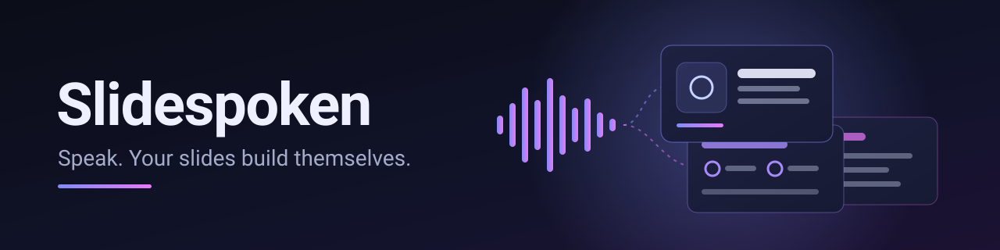
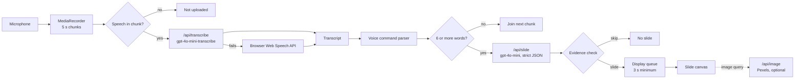
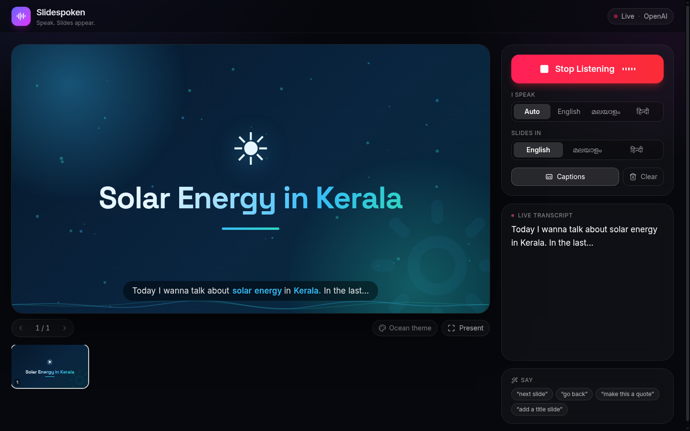
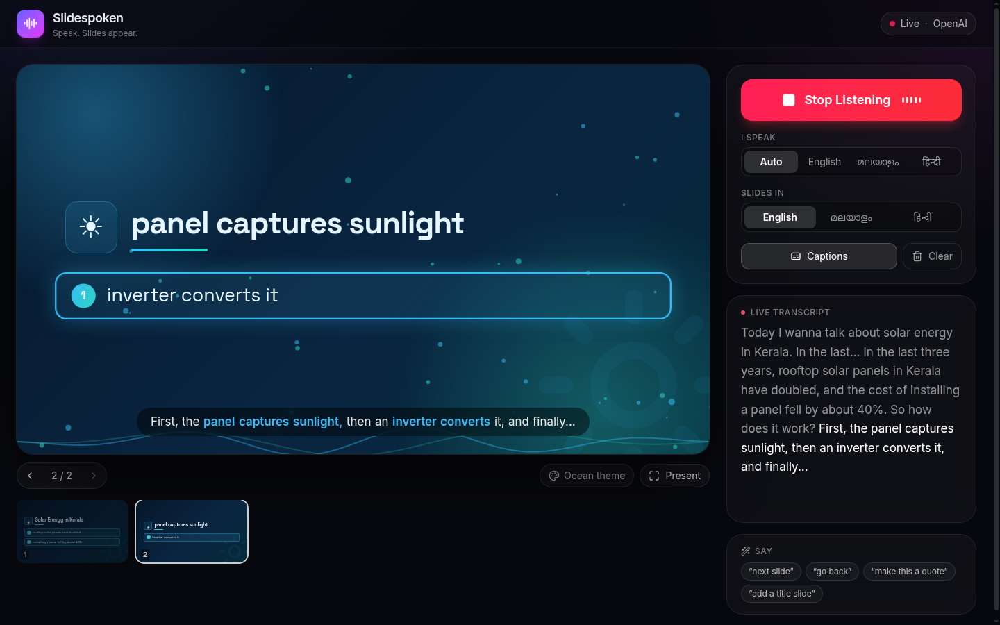
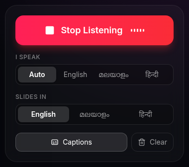

<p align="center">
  
</p>

<p align="center"><strong>Devin Hacks Kochi | Team SenseStreet</strong></p>

<p align="center">
  
  
  
  
  
</p>

Slidespoken is a web app for presenters. You speak in English, Malayalam or Hindi, and slides are built live from what you say.

---

## Problem

Making slides takes time, and live talks rarely follow the deck exactly. Speakers who present in Malayalam or Hindi have even fewer tools that understand their language.

## Solution

Slidespoken listens to the presenter and turns each few seconds of speech into a short, designed slide. It can translate: you can speak Malayalam and get English slides, or the other way round.

## Key idea: grounded slides

Slides must only contain what the speaker said.

- Each slide is built from the current 5-second chunk only. The previous chunk is sent as context, not as a source.
- The model must attach an evidence phrase, copied from the transcript, to every bullet and to the title.
- The server checks each evidence phrase against the transcript and drops any bullet it cannot match (`src/lib/grounding.ts`).
- If a chunk is only greetings or filler, the model returns `skip` and no slide is made.
- Names and numbers are kept as transcribed. Slides are never "corrected".

## How it works

| Step | What happens | Value in code |
|---|---|---|
| Record | The mic records continuously in fixed chunks. Each chunk uses a fresh `MediaRecorder`, so every file is complete. | 5 s (`CHUNK_MS`) |
| Silence check | A chunk with less than 300 ms of speech is not uploaded. | `MIN_VOICED_MS = 300` |
| Transcribe | `/api/transcribe` sends the chunk to `gpt-4o-mini-transcribe`. | — |
| Carry over | A chunk with fewer than 6 words waits and is joined to the next chunk. | `MIN_CHUNK_WORDS = 6` |
| Generate | `/api/slide` asks `gpt-4o-mini` for a strict JSON slide, then checks the evidence. | — |
| Display | A ready slide is held until the current slide has been visible for at least 3 seconds. The screen is never blank. | `MIN_DISPLAY_MS = 3000` |

Measured in one end-to-end run (headless Chrome, recorded English speech as the mic): the first transcript text appeared 5.8 s after pressing Start, and the first slide appeared 7.3 s after Start.



---

## Screenshots

<p align="center">
  
</p>
<p align="center"><em>Slide canvas: the first slide, built from the first chunk of speech.</em></p>

<p align="center">
  
</p>
<p align="center"><em>Live transcript and captions. The bullet the speaker is talking about is highlighted.</em></p>

<p align="center">
  
</p>
<p align="center"><em>Language selector: the spoken language (or Auto) and the slide language are set separately.</em></p>

---

## Technology stack

Versions are from `package.json`.

| Area | Technology |
|---|---|
| Framework | Next.js 15.5.28 (App Router), React 19.1.0 |
| Language | TypeScript 5 (strict) |
| Styling | Tailwind CSS 4 |
| Validation | zod 4 |
| AI | OpenAI Node SDK 6: `gpt-4o-mini-transcribe` (speech to text), `gpt-4o-mini` (slides, JSON schema output) |
| Icons | lucide-react |
| Tests and checks | Vitest 3, ESLint 9, `tsc --noEmit` |

## Run the project

### Prerequisites

These versions were used to verify every step below:

- Node.js 20.20.2 (`package.json` requires Node 20 or newer)
- npm 10.8.2
- An OpenAI API key
- Chrome, for microphone recording

### Install dependencies

```bash
git clone https://github.com/thomson-leo-thomas/SlideSpoken.git
cd SlideSpoken
npm install
```

### Environment setup

```bash
cp .env.example .env.local
```

Then fill in `.env.local`:

| Variable | Required | Purpose |
|---|---|---|
| `OPENAI_API_KEY` | Yes | Transcription and slide generation. Read only on the server. |
| `PEXELS_API_KEY` | No | Background photos for slides. Without it, slides have no photo. |

Never commit `.env.local`. It is ignored by `.gitignore`.

### Start the project

```bash
npm run dev
```

Open http://localhost:3000, press **Start Listening** and allow the microphone.

### Run checks and tests

```bash
npm test            # Vitest
npm run lint        # ESLint
npm run typecheck   # TypeScript
npm run build       # production build
```

A passing run looks like this:

- `npm test`: `Test Files 11 passed (11)` and `Tests 100 passed (100)`.
- `npm run lint` and `npm run typecheck`: no errors, exit code 0.
- `npm run build`: `✓ Compiled successfully` and a route table listing `/`, `/api/image`, `/api/slide` and `/api/transcribe`.

---

## Current status

### Working features

Verified by running the app, calling the API routes, or unit tests:

- Start/Stop Listening with continuous 5-second recording and live transcript.
- Speech in English, Malayalam and Hindi, with an Auto option that detects the spoken language.
- Slides in English, Malayalam or Hindi, translated when the spoken language is different.
- Grounded slides: evidence check, `skip` for filler, carry-over of short chunks.
- Six slide layouts: title, bullets, quote, metric, diagram (flow, steps, cycle) and compare.
- A theme picked from the topic (8 themes with their own colours, fonts and slide transitions), plus one emoji per slide.
- Word-by-word live captions and highlighting of the bullet being spoken.
- Voice commands: "next slide", "go back", "make this a quote", "add a title slide".
- Slide thumbnails, keyboard navigation and a fullscreen Present mode.
- If slide generation fails, the raw transcript is shown as a bullet slide.
- If OpenAI transcription fails, the app switches to the browser Web Speech API.

### Known limitations

- Slides appear about 3 seconds after speech, because audio is processed in 5-second chunks.
- Tested mainly in Chrome. Other browsers may not support microphone recording.
- Malayalam and Hindi transcription can be less accurate than English. Slides show the words as transcribed and are never "corrected."
- Translated slides can still be wrong. The evidence check cannot compare words across scripts, and in one Malayalam-to-English test a slide merged two facts into "Rooftop panels doubled in cost".
- There is no rate limiting, session cap or same-origin check yet (planned for M6). Do not deploy publicly with a paid API key before these are added.

## Libraries, APIs and public datasets

| Name | Used for | Link |
|---|---|---|
| Next.js | App framework | https://nextjs.org |
| React | UI | https://react.dev |
| TypeScript | Language | https://www.typescriptlang.org |
| Tailwind CSS | Styling | https://tailwindcss.com |
| zod | Validation of API input and model output | https://zod.dev |
| OpenAI Node SDK and API | Transcription and slide generation | https://github.com/openai/openai-node |
| lucide-react | Icons | https://lucide.dev |
| server-only | Keeps the OpenAI client out of browser bundles | https://www.npmjs.com/package/server-only |
| Google Fonts via `next/font` | Inter, Outfit, Space Grotesk, Playfair Display, Noto Sans Malayalam, Noto Sans Devanagari (SIL Open Font License) | https://fonts.google.com |
| Pexels API | Optional slide photos. Photographer credit is shown on each photo. | https://www.pexels.com/api/ |
| Web Speech API, MediaRecorder, Web Audio | Browser speech fallback, recording, silence detection | https://developer.mozilla.org/docs/Web/API/Web_Speech_API |
| Vitest, ESLint | Tests and linting | https://vitest.dev, https://eslint.org |

Photos provided by Pexels. The Pexels code path was only tested without a key (the app shows no photo); it has not been tested with a real key.

No public datasets are used.

---

## Features by milestone

| Milestone | Scope | Status |
|---|---|---|
| M1 | Scaffold, mic recording, `/api/transcribe`, live transcript, language selector | Done |
| M2 | `/api/slide` with zod validation, slide rendering and animations | Done |
| M3 | Voice commands, Pexels images, fallback slide | Done (Pexels not tested with a real key) |
| Polish | Topic themes, emoji, diagrams, translation, live captions, voice-reactive effects, grounded 5-second pipeline | Done |
| M4 | PPTX and PDF export | Not started |
| M5 | Audience Q&A page (`/ask`) and Q&A slide | Not started |
| M6 | Rate limiting, session cap, caching, same-origin checks, README, demo script, Vercel config | In progress (README only) |

## Reliability and safety

- API keys are read only on the server. `src/lib/openai.ts` imports `server-only`, and no key uses a `NEXT_PUBLIC_` prefix.
- Every API input and every model response is validated with zod.
- The slide model uses strict JSON schema output, and the server drops bullets without matching evidence.
- Chunks without speech are not sent to the API, because speech models can invent text for silence.
- If slide generation fails, the transcript is shown as a bullet slide. If transcription fails, the browser's speech recognition takes over.
- `/api/image` returns no photo instead of an error when Pexels is not configured or fails.

## Evaluation

Ten sample transcripts were sent to `/api/slide` on the local server, each with an empty deck. Latency is the measured time for the full request. "Grounded" means every title and bullet states something in the transcript, checked by reading each output.

| # | Spoken | Slides in | Transcript (short) | Result | Grounded | Latency |
|---|---|---|---|---|---|---|
| 1 | English | English | Good morning everyone, thanks for coming… | skip (filler) | Yes | 0.72 s |
| 2 | English | English | Today I want to talk about solar energy in Kerala… | title: Solar Energy Growth in Kerala | Yes | 1.06 s |
| 3 | English | English | …rooftop solar panels in Kerala have doubled | bullets: doubled in the last three years | Yes | 1.27 s |
| 4 | English | English | First the panel captures sunlight, then an inverter… | diagram: 3 steps | Yes | 1.34 s |
| 5 | English | English | Compared to diesel generators, solar is quieter… | compare: solar vs diesel | Yes | 1.35 s |
| 6 | English | English | Our school started a recycling program… | bullets: Collected two tons of plastic | Yes | 1.25 s |
| 7 | Malayalam | Malayalam | ഇന്ന് ഞാൻ കേരളത്തിലെ സൗരോർജ്ജത്തെക്കുറിച്ച്… | bullets in Malayalam, 2 points | Yes | 1.57 s |
| 8 | Malayalam | English | (same as 7) | bullets: Roof-top panels doubled in three years | Yes | 1.20 s |
| 9 | Hindi | Hindi | आज मैं केरल में सौर ऊर्जा के बारे में… | bullets: छत पर लगे पैनल दोगुने हो गए हैं | Yes | 1.43 s |
| 10 | English | Hindi | Our school started a recycling program… | bullets: छह महीने में दो टन प्लास्टिक | Yes | 1.34 s |

Result: 10 of 10 grounded. Median latency 1.31 s, maximum 1.57 s.

Two end-to-end runs used a recorded voice as the microphone. In the English run, the slides matched the speech. In the Malayalam-to-English run, one slide combined two facts incorrectly (see Known limitations).

Transcription accuracy (word error rate): not yet evaluated.

## Built with Devin

This project was built with [Devin](https://devin.ai) by Cognition. Devin wrote the code, the tests and this README, and ran the checks and the evaluation above. The team reviewed each milestone and gave feedback on design and behaviour.

## Project structure

```
src/
  app/
    page.tsx                 main presenter screen
    api/transcribe/route.ts  audio chunk -> text (OpenAI)
    api/slide/route.ts       transcript -> grounded slide (OpenAI)
    api/image/route.ts       image query -> Pexels photo (optional)
  components/                slide canvas, slide layouts, captions, effects, controls
  hooks/
    useTranscriber.ts        5-second recording, silence check, Web Speech fallback
    useSlideGenerator.ts     carry-over, slide requests, 3-second display queue
    useSlideImages.ts        background photo loading
  lib/                       schemas, prompt, grounding, deck logic, themes, commands (unit-tested)
docs/banner.svg              README banner
screenshots/                 README screenshots
```

## Roadmap

- M4: export the deck as PPTX and PDF in the browser.
- M5: audience Q&A page (`/ask`) and a Q&A slide.
- M6: rate limiting per IP, 15-minute session cap with countdown, `/api/slide` caching, same-origin checks, demo script, Vercel config.
- Measure transcription accuracy for Malayalam and Hindi.
- Add a license file.

## Team

Team SenseStreet, Devin Hacks Kochi.

- Thomson Leo Thomas ([@thomson-leo-thomas](https://github.com/thomson-leo-thomas))

## License

No license file has been added yet, so all rights are reserved by the authors for now.
